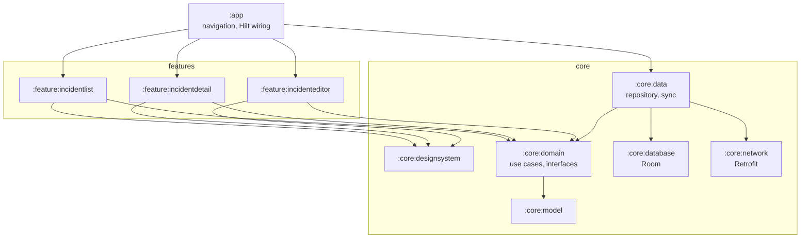

# Field Incident Reporter

Field technicians photograph and report physical incidents (broken equipment, road hazards) from an
Android app. Reports are saved on the device first and synced in the background, so the app keeps
working in basements, plant rooms and anywhere else the signal drops.

| Folder | What |
|---|---|
| [`android/`](android/) | Android app: Kotlin, Jetpack Compose, MVVM + use cases, Hilt, Room, WorkManager, Navigation 3 |
| [`server/`](server/) | Local mock API (json-server with photo uploads) and its [OpenAPI contract](server/openapi.yaml) |
| [`docs/`](docs/) | [Architecture decision records](docs/adr/) and the AI usage log |

## Quick start

Requirements: Node.js 20+, and Android Studio (stable) with an emulator or a device on API 26+.

```bash
# 1. Mock API, seeded with sample incidents
cd server
npm install
npm start                 # http://localhost:3000

# 2. App (or open android/ in Android Studio and run "app")
cd android
./gradlew installDebug
```

The emulator reaches the API at `http://10.0.2.2:3000`, the default. For a physical device, or an
emulator without network access, forward the port and point the app at it:

```bash
adb reverse tcp:3000 tcp:3000
echo "api.baseUrl=http://localhost:3000/" >> android/local.properties   # then reinstall
```

Notes:
- From the command line, Gradle needs the Android SDK location: set `ANDROID_HOME`, or open the
  project once in Android Studio (it writes `android/local.properties`).
- On Windows, clone to a short path or run `git config --global core.longpaths true`.
- `npm run reset` restores the seed data. `DELAY_MS=2000 npm start` slows every request down and
  `FAIL_STATUS=500 npm start` makes every app write fail, to see the loading and retry states
  (PowerShell: `$env:FAIL_STATUS=500; npm start`).

## What the app does

- **Report** an incident: title, category, severity, location, description, and up to 6 photos
  from the camera or the gallery (system camera and Photo Picker, so no permissions are needed).
- **View** incidents, newest first, filtered by status; open one to see its photos and details.
- **Edit** or **delete** an incident, with undo. Resolved incidents are read-only: resolving is an
  operator decision ([ADR-0005](docs/adr/0005-status-ownership.md)).
- **Work offline.** Every change is saved locally right away and synced when a connection is back.
  Each incident shows whether it's waiting to sync or was rejected, and a rejected change can be
  retried or discarded.
- Dark theme, dynamic color, edge-to-edge, predictive back, TalkBack labels. A draft in progress,
  and a photo being taken, survive the app being killed in the background.

## Scope decisions

| Built | Deliberately left out, and why | What production would add |
|---|---|---|
| Offline-first sync with per-incident status, retry and discard | GPS capture: a free-text location is enough for the prototype, and a permission flow adds no architectural signal | Conflict detection with versions or ETags (`If-Match`) instead of last-write-wins |
| Idempotent writes (client UUIDs + `PUT` upsert) | Authentication and user accounts | A real backend with auth, per-tenant ids and server-side validation of client ids |
| Photo capture, compression and upload | Cleaning up uploads orphaned by deleted photos | Upload deduplication and an orphan sweep |
| Undo for deletes | Paging: a technician's incident list is small | Paging (Paging 3) and incremental sync (`updatedSince`) |
| Resolved incidents locked for technicians (`409`) | Adaptive list-detail layout for tablets | Crash reporting, analytics, release signing and R8 rules review |
| Unit, integration and Compose UI tests in CI | A Japanese translation (strings are all resources, ready for it) | Screenshot tests and instrumented end-to-end tests on devices |

## Architecture



- **Layers.** Screens follow MVVM with unidirectional data flow: a ViewModel exposes one immutable
  UI state and calls use cases; business rules (validation, "resolved is read-only") live in the
  use cases in `:core:domain`, a pure Kotlin module. Features can't see the data layer at all; the
  module graph enforces it.
- **Offline-first.** Room is the single source of truth; the UI only observes the database. Each
  write runs in one transaction through a small state machine
  ([`SyncTransitions.kt`](android/core/data/src/main/kotlin/com/akerusan/fieldincidentreporter/core/data/sync/SyncTransitions.kt))
  and schedules a sync. One WorkManager job pushes pending changes, then pulls the server's list.
- **Async correctness.** A per-row version that only grows makes server confirmations conditional,
  so an edit saved while its upload is in flight is never marked as synced by mistake. Syncs run
  under a single unique work name, so they never overlap. The pull never overwrites unsent changes.
- **Errors.** No connection: the change waits and is retried, never lost. Server errors: retried
  with backoff, then flagged. Rejections (4xx, including `409` for resolved incidents): flagged
  right away with the reason, and the user can retry or discard.

The reasoning behind each choice is in [`docs/adr/`](docs/adr/).

## API contract

The full contract is [`server/openapi.yaml`](server/openapi.yaml), linted in CI.

| Method | Path | Notes |
|---|---|---|
| `GET` | `/incidents` | Filters: `status`, `severity`, `category`. Sort: `_sort=reportedAt&_order=desc` |
| `GET` | `/incidents/{id}` | |
| `PUT` | `/incidents/{id}` | **Upsert**: creates (201) or replaces (200). Ids are generated on the device, so retries are safe |
| `PATCH` | `/incidents/{id}` | Operator triage: `status` (and `updatedAt`) only |
| `DELETE` | `/incidents/{id}` | `404` means already deleted |
| `POST` | `/uploads` | Multipart `file` (JPEG/PNG/WebP, max 10 MB), returns `{ "path": "/uploads/…" }` |

Errors share one shape, `{ "code": "...", "message": "..." }`. Once an operator resolves an
incident, `PUT` and `DELETE` from the app return `409 INCIDENT_RESOLVED`.

## Testing

```bash
cd android && ./gradlew spotlessCheck assembleDebug testDebugUnitTest lintDebug
cd server  && npm run lint:api && npm run smoke
```

- **Domain:** every use case, against fakes from `:core:testing`.
- **Data:** the sync state machine row by row, and the repository and sync engine against an
  in-memory database and a scripted mock server, including the race conditions above.
- **UI:** ViewModel tests for each screen, and Compose UI tests that run on the JVM (Robolectric).
- **API:** an end-to-end smoke test of every endpoint.

All of it runs in CI on every pull request.
